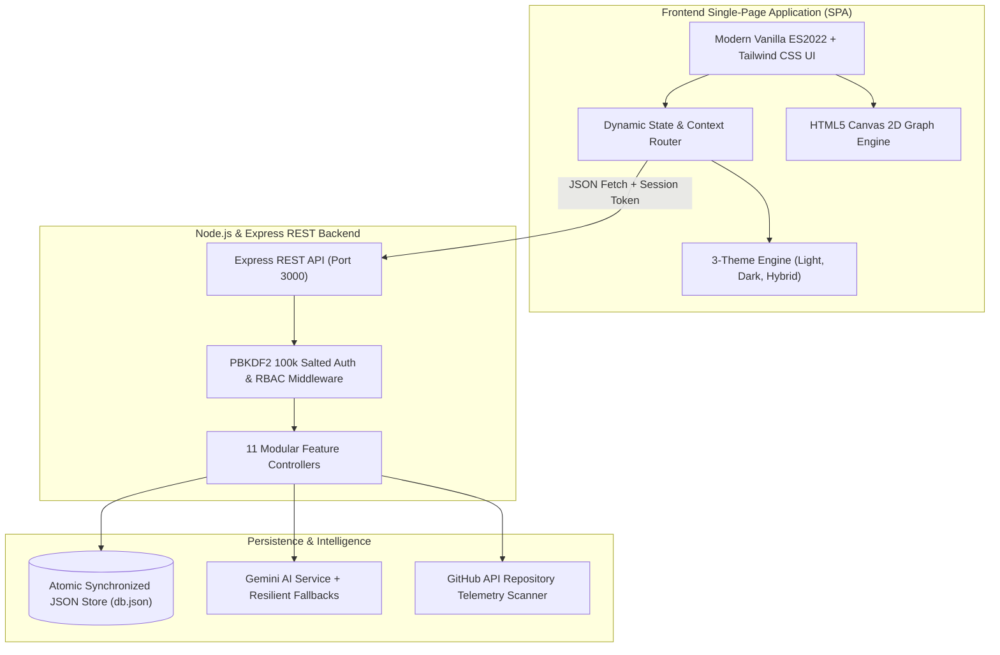
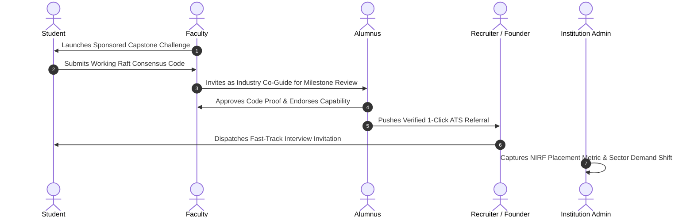

# 🚀 LinkX — Opportunity Operating System for Campus Ecosystems
> **Track 1:** Alumni Network & Professional Connections  
> **Official Submission:** [Hackshift GenX AI Hackathon](https://github.com/dhanivarshney/Hackshift-GenX-AI-)  
> **Core Thesis:** Transforming inactive alumni directories into an active, verified, outcome-driven ecosystem.

[](https://github.com/dhanivarshney/Hackshift-GenX-AI-)
[](https://github.com/dhanivarshney/Hackshift-GenX-AI-)
[](https://github.com/dhanivarshney/Hackshift-GenX-AI-)
[](https://github.com/dhanivarshney/Hackshift-GenX-AI-)

---

## 📑 Table of Contents
1. [The Real-World Problem](#-the-real-world-problem)
2. [The LinkX Solution](#-the-linkx-solution)
3. [6-Persona Ecosystem Matrix](#-6-persona-ecosystem-matrix)
4. [Judge Quick Start & Test Credentials](#-judge-quick-start--test-credentials)
5. [System Architecture & Visual Diagrams](#-system-architecture--visual-diagrams)
6. [Key WOW Features](#-key-wow-features)
7. [Three User-Selectable Themes](#-three-user-selectable-themes)
8. [Automated Test Suite (39/39 Passing)](#-automated-test-suite-3939-passing)
9. [Complete API Reference](#-complete-api-reference)
10. [Repository & Branch Structure](#-repository--branch-structure)

---

## 💥 The Real-World Problem

Every year, universities build "Alumni Directories" and career portals. Within 90 days of graduation, **over 92% of alumni stop visiting**. Why?

| The Status Quo Failure | The Reality on the Ground |
|---|---|
| **Cold-DM Spam Tragedy** | Students blindly message senior alumni on LinkedIn asking *"Can you refer me?"* with zero prior relationship or verified context. |
| **Alumni Fatigue & Ghosting** | Senior alumni receive dozens of generic copy-paste outreach messages each week, have no way to verify candidate competence, and end up ghosting everyone. |
| **Recruiter Screening Burden** | Recruiters drown in hundreds of inflated resumes that pass keyword filters but fail the first 10 minutes of technical screening. |
| **Faculty & Department Disconnection** | Capstone projects and research papers gather dust in academic archives instead of solving industry problems with alumni co-mentorship. |
| **Institutional Blind Spots** | Colleges only learn about placement drop-offs 6 months after graduation, leaving no room for agile curriculum adjustments. |

---

## 💡 The LinkX Solution

LinkX is not a directory. It is an **Opportunity Operating System (Opportunity OS)** that turns the college ecosystem into a self-sustaining circular economy:

```
Students        ---> Deliver verified Proof-of-Work & solve faculty challenges
Alumni          ---> Provide high-conviction 1-click ATS referrals & 1:1 mentorship
Faculty         ---> Supervise industry capstones & bridge research squads
Founders        ---> Post real escrowed micro-bounties for 48-hour student sprints
Recruiters      ---> Use NLP Copilot to hire candidates ranked by real code artifacts
Institutions    ---> Track live NIRF/NAAC accreditation metrics & skill gap radar
```

---

## 👥 6-Persona Ecosystem Matrix

Every stakeholder has a distinct purpose on LinkX, and all six roles directly reinforce each other:

| Persona | Primary Goal | What They Receive | What They Contribute |
|---|---|---|---|
| **🎓 Student** | Land high-conviction careers & bounties | Structured 4-phase missions, verified capability dossier, contingency rescue plans | Production code, challenge solutions, open-source commits |
| **💼 Alumnus** | Give back with zero noise | Pre-screened referral queue, structured calendar slots, Legacy Graph authorship | High-trust company referrals, technical playbooks, mentorship |
| **🚀 Founder** | Rapid feature prototyping | High-velocity student engineering squads in 48 hours | Escrow-backed micro-bounties (₹3k–₹12k), real startup experience |
| **🏛️ Faculty** | Bridge academic theory to industry | Industry co-guides from top tech, milestone review harness | Sponsored capstone challenges, student research supervision |
| **🎯 Recruiter** | Zero-fluff technical hiring | Instant NLP candidate shortlists with verified GitHub code proofs | Fast-track interview invitations, corporate hiring access |
| **🏫 Institution** | Accreditation & placement velocity | Real-time sector demand radar, 1-click NAAC/NIRF CSV exports | Ecosystem governance, departmental quotas, verified student credentials |

---

## 🔑 Judge Quick Start & Test Credentials

You can test the entire platform locally in under **60 seconds**.

### 1. Installation & Bootstrapping
```bash
# Clone the repository
git clone https://github.com/dhanivarshney/Hackshift-GenX-AI-.git
cd Hackshift-GenX-AI-

# Install dependencies
npm install

# Start the full-stack engine (Auto-hosts API & SPA at http://localhost:3000)
npm start
```
Open **[http://localhost:3000](http://localhost:3000)** in your browser.

### 2. Pre-Configured Judge Credentials
LinkX comes pre-populated with ready-to-test accounts across all 6 personas. All default test accounts share the universal judge password:

> **Universal Judge Password:** `Password123!`

| Role | Test Email | Display Name | Notable Views to Test |
|---|---|---|---|
| **Student** | `student@apex.edu` | Aman Sharma | Career Missions, Career Shadow Simulation, Opportunity Rescue |
| **Alumnus** | `alumni@google.com` | Rohan Mehta (Staff SWE, Google) | Referral Queue, Mentorship Calendar, Legacy Knowledge Graph |
| **Founder** | `founder@stealth.ai` | Vikram Sen (Founder, Stealth AI) | Micro-Bounty Engine, PR Review Desk, Fast Squad Builder |
| **Faculty** | `faculty@apex.edu` | Dr. R.K. Verma (Professor, CS) | Capstone Challenge Exchange, Milestone Grading, Alumni Co-Guides |
| **Recruiter** | `recruiter@stripe.com` | Priya Nair (Lead Tech Recruiter) | Natural Language Hiring Copilot, Proof-of-Work Shortlists, CSV Export |
| **Institution** | `admin@apex.edu` | Dean Sharma (Dean of Placement) | Executive Overview, Sector Demand Radar, NAAC/NIRF CSV Export |

*Note: You can also use the **Quick Persona Switcher** on the login screen or register an entirely new account with PBKDF2 cryptographic hashing.*

---

## 🏛️ System Architecture & Visual Diagrams

### 1. Architectural Topology


### 2. Circular Opportunity Flow


---

## 🌟 Key WOW Features

### 1. 🛡️ Career Shadow AI Simulations
- Provides students with realistic 4-step engineering architecture incidents (e.g., *High-Throughput Order Ingestion Failure*).
- Real-time scoring using multi-dimensional rubrics (System Resiliency, Latency Bottleneck Analysis, Tradeoff Clarity).
- Provides transparent feedback, letting students prove architectural thinking before interviews.

### 2. 🛟 Opportunity Rescue Contingency Engine
- Solves the silent crisis of rejected applications and hiring freezes.
- When an internship or dream application falls through, LinkX automatically analyzes the student's capability profile and generates **3 immediate pivot branches**:
  1. High-yield open-source contribution targets.
  2. Urgent ₹8,000 founder micro-bounties matching current skills.
  3. Closely related faculty capstone challenges.

### 3. 🌉 Hidden Bridge Finder (Multi-Hop Consent Introductions)
- Solves the cold-DM dilemma through warm academic and project lineage paths.
- Computes multi-step connection paths (e.g., `Student -> Dr. Verma (Faculty) -> Rohan Mehta (Google Alumnus)`).
- Double opt-in consent protects alumni from spam while guaranteeing students a warm introduction with verified context.

### 4. 🤖 Natural Language Recruiter Hiring Copilot
- Recruiters can type real conversational queries: *"Need a backend engineer who has built distributed cache systems with Go or Rust."*
- LinkX extracts skills, scans candidate GitHub pull requests and capstone milestone grades, and outputs a ranked shortlist with verified proof-of-work badges.
- Includes 1-click **ATS CSV Export** and instant interview dispatch.

### 5. 🏛️ Institutional Compliance & Accreditation Engine
- Designed specifically for university placement cells and accreditation committees.
- 1-Click official CSV export formatted to **NAAC Criterion V** and **NIRF** placement reporting requirements.
- Real-time sector demand radar flags underserved engineering branches before placement season concludes.

---

## 🎨 Three User-Selectable Themes

LinkX includes three fully designed, high-contrast, accessible themes:

1. **Light Theme (`.theme-light`):**
   - Clean slate canvas (`#f8fafc`) with deep charcoal typography (`#0f172a`).
   - Ideal for daytime document reading and academic evaluation.
2. **Dark Theme (`.theme-dark`):**
   - High-contrast obsidian background (`#030712`) with midnight navy cards (`#0a0f1d`) and emerald/indigo accents.
   - Tailored for high-focus software development workflows.
3. **Hybrid Theme (`.theme-hybrid` — Best of Both Worlds):**
   - **Top Navigation Bar:** Deep slate-950 (`#020617`) with glowing brand emblems and white icons.
   - **Content Canvas:** Clean white/slate-100 surfaces with dark readable typography.
   - High-tech SaaS presentation with zero eye strain.

*Zero Flash Guarantee:* Theme choices persist in `localStorage` and automatically sync to the backend user settings via `/api/auth/settings`. An inline `<head>` bootstrap script ensures zero theme flicker on page reloads.

---

## 🧪 Automated Test Suite (39/39 Passing)

LinkX is backed by an automated integration test suite written with Node.js native test runner (`node:test` & `node:assert/strict`).

```bash
# Execute the complete automated test suite
npm test
```

### Verified Test Run Output:
```text
✔ LinkX Full-Stack Platform End-to-End Test Suite
  ✔ GET /api/personas should return verified platform personas
  ✔ GET /api/analytics should return platform KPIs
  ✔ POST /api/auth/register should create a new student account
  ✔ POST /api/auth/login should authenticate valid credentials
  ✔ POST /api/auth/login should reject invalid credentials
  ✔ GET /api/auth/me should return current user profile with token
  ✔ POST /api/auth/settings should persist user theme and preferences
  ✔ POST /api/auth/forgot-password & reset-password flow
  ✔ GET /api/student/missions should return 4-phase career roadmap
  ✔ POST /api/student/missions/tasks/toggle should toggle task status
  ✔ POST /api/student/opportunity-rescue should compute pivot contingency options
  ✔ GET /api/career-shadow/scenarios should return simulation tracks
  ✔ POST /api/career-shadow/evaluate should grade user responses with transparent rubrics
  ✔ GET /api/bridge/paths should return multi-hop introduction paths
  ✔ POST /api/bridge/request & POST /api/bridge/status consent workflow
  ✔ GET /api/alumni/mentorship/slots & POST /api/alumni/mentorship/book
  ✔ POST /api/alumni/mentorship/status updates session lifecycle
  ✔ POST /api/legacy-graph/posts creates a searchable knowledge resource
  ✔ POST /api/legacy-graph/upvote increments reputation votes
  ✔ GET /api/legacy-graph returns updated repository with tags
  ✔ POST /api/faculty/challenges creates new capstone/sponsored challenge
  ✔ POST /api/faculty/challenges/apply submits a squad application
  ✔ POST /api/recruiter/copilot evaluates natural language requirements
  ✔ GET /api/recruiter/export-csv returns downloadable proof-of-work candidate export
  ✔ POST /api/recruiter/invite dispatches fast-track interview invitation
  ✔ GET /api/institution/gap-radar returns institutional intelligence metrics
  ✔ GET /api/notifications & POST /api/notifications/mark-read
  ✔ GET /api/messages/conversations & POST /api/messages/send
  ✔ GET /api/faculty/dashboard should return comprehensive faculty metrics
  ✔ GET /api/faculty/students should return student dossiers with capability scores
  ✔ GET /api/faculty/supervision & POST /api/faculty/supervision/review should update milestone score
  ✔ GET /api/faculty/collaborations & POST /api/faculty/collaborations/invite should invite alumni co-guide
  ✔ GET /api/faculty/profile & PUT /api/faculty/profile should update academic preferences
  ✔ GET /api/institution/overview should return university-wide executive metrics
  ✔ GET /api/institution/intelligence should return real-time sector demand and alerts
  ✔ POST /api/institution/departments should enforce RBAC (403 for non-admins, 201 for admins)
  ✔ GET /api/institution/outcomes & GET /api/institution/export-outcomes-csv should deliver accreditation records
  ✔ GET /api/institution/governance & POST /api/institution/governance should update policies and record audit logs

# tests 39 | pass 39 | fail 0 | cancelled 0
```

---

## 🌐 Complete API Reference

| Method | Endpoint | Persona | Purpose |
|---|---|---|---|
| `GET` | `/api/personas` | Public | Lists verified platform roles and personas |
| `GET` | `/api/analytics` | Public | Real-time ecosystem performance KPIs |
| `POST` | `/api/auth/register` | Public | PBKDF2-salted user account creation |
| `POST` | `/api/auth/login` | Public | Token-based session authentication |
| `GET` | `/api/auth/me` | Authenticated | Fetches profile using Bearer token |
| `POST` | `/api/auth/settings` | Authenticated | Persists user theme (`light`, `dark`, `hybrid`) |
| `GET` | `/api/student/missions` | Student | 4-phase goal-to-referral roadmap |
| `POST` | `/api/student/opportunity-rescue` | Student | Generates 3 contingency pivot alternatives |
| `GET` | `/api/career-shadow/scenarios` | Student | Lists technical simulation tracks |
| `POST` | `/api/career-shadow/evaluate` | Student | Evaluates incident response with rubric scoring |
| `GET` | `/api/bridge/paths` | Student | Discovers multi-hop warm connection paths |
| `POST` | `/api/bridge/request` | Student | Submits consent-based introduction request |
| `GET` | `/api/alumni/mentorship/slots` | Alumnus / Student | Mentorship availability and booking slots |
| `POST` | `/api/alumni/mentorship/book` | Student | Reserves 1:1 structured guidance session |
| `GET` | `/api/legacy-graph` | Alumnus / All | Searchable engineering playbooks & retrospectives |
| `POST` | `/api/legacy-graph/posts` | Alumnus | Authors a new peer-reviewed knowledge resource |
| `GET` | `/api/faculty/dashboard` | Faculty | Supervisions, student talent rosters, and deadlines |
| `GET` | `/api/faculty/students` | Faculty | Capability scores & GitHub verification records |
| `POST` | `/api/faculty/supervision/review` | Faculty | Grades and reviews capstone project milestone |
| `POST` | `/api/faculty/collaborations/invite`| Faculty | Invites alumni co-guide to co-mentor squad |
| `GET` | `/api/institution/overview` | Institution | University placement macro KPIs & top employers |
| `GET` | `/api/institution/intelligence` | Institution | Emerging sector demand & underserved alerts |
| `POST` | `/api/institution/departments` | Institution | RBAC-protected academic department configuration |
| `GET` | `/api/institution/export-outcomes-csv`| Institution | Official NAAC & NIRF placement compliance export |
| `POST` | `/api/institution/governance` | Institution | Privacy, scrape protection & security policies |
| `POST` | `/api/recruiter/copilot` | Recruiter | Natural language candidate extraction and ranking |
| `GET` | `/api/recruiter/export-csv` | Recruiter | Exports candidate proof-of-work shortlist to CSV |
| `POST` | `/api/recruiter/invite` | Recruiter | Dispatches fast-track interview invitation |

---

## 🌿 Repository & Branch Structure

The repository is structured to adhere to professional open-source submission standards:

- **`main`**: The primary production-grade, judge-ready release branch containing the clean modular architecture, comprehensive documentation, and 39/39 passing test suite.
- **`submission/hackshift-final`**: The official submission snapshot tag/branch for hackathon evaluation.
- **`develop`**: The continuous development integration branch.
- **`feature/opportunity-os-v2`**: Feature branch containing the circular syndicate economic prototypes.

### Quick Verification for Judges
```bash
# Verify branch and working tree
git status

# Verify test suite passes cleanly
npm test

# Launch the platform
npm start
```

---

## 🏆 Hackshift GenX Hackathon Submission Details

- **Project Name:** LinkX
- **Submission Track:** Track 1 — Alumni Network & Professional Connections
- **GitHub Repository:** [https://github.com/dhanivarshney/Hackshift-GenX-AI-](https://github.com/dhanivarshney/Hackshift-GenX-AI-)
- **Team Name:** GenX AI Builders
- **License:** MIT License
