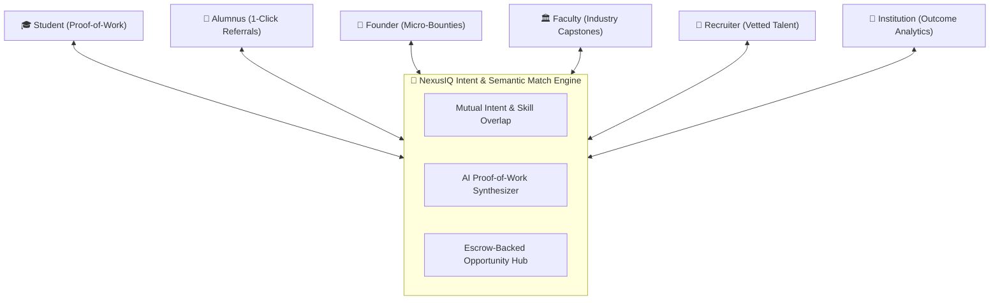

# 🚀 NexusIQ: Campus & Alumni Intent Network
> **Track 1:** Alumni Network & Professional Connections  
> **Theme:** *Building a Network, Not a Directory*  
> **Mission:** Connecting students, alumni, faculty, founders, recruiters, and institutions based on **Expertise**, **Intent**, and **Opportunities**.

---

## 💡 The Core Problem: Why College Alumni Portals Fail
Traditional alumni portals and LinkedIn directories are **dead digital graveyards**:
1. **Directories vs. Networks:** A directory lists 5,000 names (where people work). A **network** actively pairs people when their **Intent and Expertise align**.
2. **The Cold-DM Spam Crisis:** Alumni at Google, Swiggy, and Microsoft get 50+ generic messages (*"Sir please refer me"*) every week. They have 0 time to review 5-page resumes, so they close their inboxes.
3. **Faculty & Founders Disconnected:** Alumni founders need quick builders for MVPs; faculty need real-world industry co-guides for student capstones. Neither uses traditional portals.

---

## ⚡ The NexusIQ Solution



---

## 🌟 4 Key Differentiators Built in the MVP:

1. **Anti-Cold-DM "Proof-of-Work" Pitch Lab:**
   - Students cannot send generic text messages.
   - Students attach an active GitHub repo or PR.
   - The engine evaluates a **Code Readiness Score (0–100)** and produces a **1-Minute Executive Dossier** for the alumnus with a **1-Click Verified Referral** button.

2. **The Intent Match Radar:**
   - Matches users based on dynamic intent states (e.g., *Alumnus: Hiring Go Interns* $\leftrightarrow$ *Student: Built Redis Caching Engine*).
   - Generates high-signal synergy explanations for why two people should talk right now.

3. **Campus Opportunity & Micro-Bounty Exchange:**
   - Direct economic value exchange: Alumni/Founders post micro-gigs (₹3,000–₹5,000) or hackathon squad travel sponsorships.
   - Students gain production experience, earn cash, and secure direct referrals.

4. **Multi-Role Live Switcher (Judges' Delight):**
   - Live navigation pills allowing instant role-switching between:
     - `[🎓 Student (Aman)]`
     - `[💼 Alumnus (Rohan @ Swiggy)]`
     - `[🚀 Founder (Neha @ HyperScale AI)]`
     - `[🏛️ Faculty (Dr. Verma)]`
     - `[🎯 Recruiter (Vikram @ Razorpay)]`
     - `[🏫 Institution (Dean Portal)]`

---

---

## 🎨 Modern React + TailwindCSS Frontend Architecture

The frontend has been upgraded to a modular **React + TailwindCSS** component structure with organized views:

```
frontend/src/ (and root src/)
├── views/
│   ├── Onboarding.js (.jsx)     # 1. Authentication Gateway with 6 Role Login Modals
│   ├── Dashboard.js (.jsx)      # 2. Intent-Driven Feed, Category Filters, Suggestions & Leaderboard
│   ├── InstitutionHub.js (.jsx) # 3. Active Institution Hub with Alumni Highlights & Recruiter Radar
│   ├── GraphView.js (.jsx)      # 4. Interactive Lineage Graph with Canvas Physics & Neon Nodes
│   ├── ProofOfWork.js (.jsx)    # 5. Proof-of-Work Pitch Lab with AST Readiness Scores & Dispatch
│   ├── BountyBoard.js (.jsx)    # 6. Opportunity Exchange, Micro-Bounties & Recruiter Job Cards
│   └── ReferralInbox.js (.jsx)  # 7. Alumnus Decision Inbox with 1-Click ATS Referral Action
├── components/
│   ├── Navbar.jsx               # Live network status pulse & quick demo switchers
│   ├── Header.jsx               # Context-aware portal badges, role switcher, karma & streaks
│   ├── IntentModal.jsx          # Broadcast active intent modal with high-signal presets
│   └── Toast.jsx                # Reactive neon toast notifications
├── context/
│   └── NexusContext.jsx         # Multi-portal state engine (Auth, Roles, Feed, Repos, ATS)
└── data/
    └── mockData.js              # Personas, Hub Nodes, Topology Graph, Bounties, and Benchmarks
```

## 🚀 How to Run the App

### Option A: Full-Stack Express Server (Serves API + Frontend)
```bash
npm install
npm start
# Server and UI running live at http://localhost:3000
```

### Option B: React + Vite Development Server
```bash
npm run frontend:dev
# Vite Hot-Reload dev server running at http://localhost:5173
```

---

## 🏆 2-Minute Hackathon Demo Script (How to Win Over Judges)

1. **The Hook (15 seconds):**
   > *"Judges, every university has an alumni portal with 10,000 names, and exactly zero people log into it. Why? Because it's a directory, not a network. NexusIQ is an active intent exchange."*
2. **Show Student Screen & Anti-Cold-DM Engine (45 seconds):**
   > *"Show Tab 2: 'Proof-of-Work Pitch Lab'. Click 'Analyze Code & Generate Dossier'. Notice how the student's raw repo is turned into a 94/100 Code Readiness card with verified test coverage. No begging, just proof."*
3. **Switch to Alumnus View (20 seconds):**
   > *"Click [Alumnus] role in the top bar. Show how Rohan at Swiggy sees this clean 1-minute card and clicks '1-Click Verified Referral'."*
4. **Show Founder & Faculty Integration (20 seconds):**
   > *"Switch to Tab 3: Opportunity Exchange. Show Neha's ₹5,000 micro-bounty for a webhook handler, and Dr. Verma's Google-mentored research capstone."*
5. **Close with Institution Impact (20 seconds):**
   > *"Switch to Tab 5: Institution Desk. Show how college administration tracks actual referral conversion (342 referrals, ₹4.2L student bounty earnings) instead of dead login counts."*
