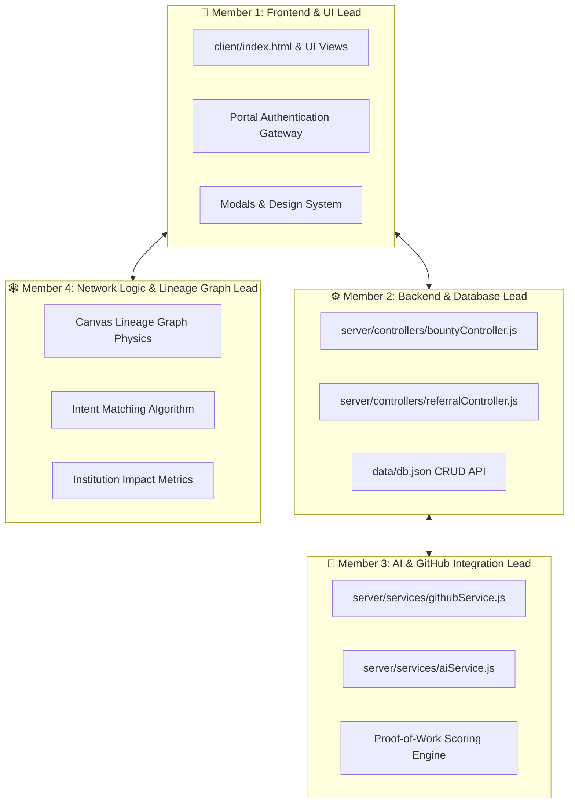

# 👥 NexusIQ: 4-Member Hackathon Team Architecture & Git Guide
> **Goal:** High-velocity collaboration without Git merge conflicts. Each member has dedicated files and clear boundaries.

---

## 🏗️ Team Ownership Matrix



---

## 📁 File Responsibilities

| Team Member | Role | Files Owned (Safe to Edit) |
| :--- | :--- | :--- |
| **Member 1 (Frontend UI/UX)** | Design & Portals | `index.html`, Auth Modals, Role Switchers |
| **Member 2 (Backend Core)** | REST APIs & DB | `server/controllers/bountyController.js`, `server/controllers/referralController.js` |
| **Member 3 (AI & GitHub)** | Code Analysis & LLM | `server/services/githubService.js`, `server/services/aiService.js` |
| **Member 4 (Data & Graph)** | Lineage & Matching | Canvas Graph in `app.js`, Institution stats, Intent Matcher |

---

## 🌿 Git Branching Strategy (Zero Conflicts)

Each team member works on their own feature branch:

```bash
# Member 1 (Frontend Lead)
git checkout -b feat/frontend-ui

# Member 2 (Backend Lead)
git checkout -b feat/backend-controllers

# Member 3 (AI Lead)
git checkout -b feat/ai-github-engine

# Member 4 (Graph Lead)
git checkout -b feat/network-lineage-graph
```

### Pull & Merge Routine:
```bash
# 1. Save your work
git add .
git commit -m "feat(role): describe change"

# 2. Sync with main
git checkout main
git pull origin main
git merge <your-branch>
git push origin main
```

---

## 🚀 Running the App
Double-click `run.bat` or run:
```bash
npm start
```
Server runs live at: **http://localhost:3000**
